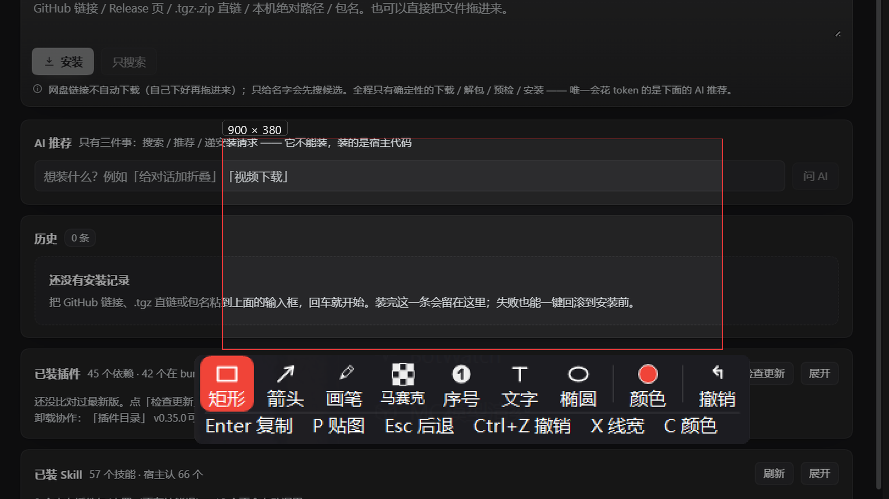

# dsh-screenshot · DSH screenshot plugin

[中文](README.md) · [English](README.en.md)

> **Status: development build (0.1.x) — not a final release.** Released as-is from daily use; features
> and UI **change from time to time**. Screen capture is a Windows-only implementation; run `shot_health`
> after any host upgrade.
>
> **状态：开发版（0.1.x），非最终版本。** 功能与界面会不定期更新；抓屏是 Windows 专有实现。



> The image above is a **demo composition**: the toolbar and selection styling come from a real render of the
> overlay (`dev/ovl-skin-shot.mjs`); the background is a screenshot of this plugin's own panel. It contains
> **no desktop, tray or session information from any machine**.

Screenshot, same as QQ: the button hangs **next to the "voice" button of the chat input box** (`conversation.input.left` slot, order `-90`).

## Capabilities

| Menu item | Description |
|---|---|
| ✂ Screenshot | **Always select a region in the native overlay** (a real full-screen window in a separate process, so it can cover other applications) → annotate → **paste into the input box + copy to the clipboard** |
| ⏺ Record screen | Recording with ffmpeg gdigrab (H.264 + faststart). **By default you first select a region, then record** (see below); a red frame on screen marks the boundary, and clicking "stop" on the timer pill at the top right finishes it. Audio can be enabled from the menu (R41, off by default) |
| Aa Extract text | **Offline OCR** after selecting a region (Windows built-in engine, nothing leaves the machine), producing a text panel that can be copied / pasted into the input box |
| 译 Translate screen | After OCR, the text (with a translation-instruction prefix) is pasted into the input box and handed to DSH's own model to translate |
| ⇕ Long screenshot | Select a region → the host posts **one wheel notch at a time**, captures a frame per notch → align and stitch the overlapping area (frames that do not overlap are reported, never guessed) → the long image returns to the annotation UI |
| ☐ Hide the DSH UI while capturing | The native overlay hides the DSH window **before freezing the desktop** (same as QQ); after selecting or cancelling, it is restored and brought back to the foreground; off by default, tick it in "More settings" |

> **As of R33 the four items "Range / Pick a window to capture / Select the range yourself / Window capture method" were removed**, along with the whole mechanism that rendered a desktop screenshot inside the DSH window
> (canvas + DOM overlay). It could only cover DSH's own window, and at 125% scaling it could only select a patch in the top-left corner of the screen — keeping it means "it looks like it works, but you can't select what you want". The only entry point now is the native
> overlay; when it is unavailable it **says so** ("restart DSH once") and no longer silently swaps in a degraded UI. The old
> `range/method/pickHwnd/pickTitle/nativeOverlay` settings are cleared once by the `prefsVer` migration.

Annotation tools: rectangle / ellipse / arrow / pen / text / mosaic, eight colours + a thickness slider, undo and redo (cursor model),
Enter to finish, Esc to cancel, Ctrl+Z/Y, Ctrl+C, Ctrl+S, Ctrl+A to select all, double-click for full screen.
There is also **pinning an image** (press `P` after selecting, or the 📌 button): the shot becomes a **topmost little
window** on the screen — the wheel or the bottom-right grip scales it (aspect ratio kept, a `W x H  N%` pill shows at the
top left), left drag moves it, double-click / `Esc` closes it, and **right click opens an action menu**: send to the input
box / copy image / save as PNG / zoom in / zoom out / actual size / close. "Send to the input box" attaches the picture to
DSH's composer straight away **and brings DSH to the front** (the next step is typing there; it also avoids "a pin that covers
the whole DSH window makes Chromium treat it as occluded and throttle the heartbeat"). The pinned window outlives the capture
that produced it, so this runs as "helper writes a file → the host picks it up on its heartbeat → the renderer attaches it";
with an old host that never polls, the pin says so instead of pretending.

The toolbar (reskinned in R66): one rounded card holding nine **vector icons with small captions** (rect / arrow / pen / mosaic / number /
text / ellipse / colour / undo). The active tool is a solid filled pill, hovering shows a soft highlight, the **shortcut line moved inside
the card** (it used to be a floating white string under the bar), and a hairline divider splits it into "tools | colour | undo". When the
selection sits near the bottom of the screen the card flips **above** it so it never covers what you are capturing. The size badge and the
magnifier use the same card language (rounded, shadowed, hairline edge, readout inside). Everything is **drawn** with GDI+ — no bitmap
assets — so it stays crisp at any DPI and the plugin remains a single plain-text `.ps1`.

Hotkeys: `Ctrl+Alt+A` screenshot, `Ctrl+Alt+O` extract text.

## Why screen capture must live on the host side

The renderer process **cannot get the screen**: the official main session has no `setDisplayMediaRequestHandler`, and the permission handler only allows
the microphone (verified file by file in `/lib/main.js`), so `getDisplayMedia()` gets no source at all.
That is why the host side uses PowerShell/.NET:

- `System.Drawing.Graphics.CopyFromScreen` → whole screen (automatically covers the multi-monitor virtual screen)
- `PrintWindow(PW_RENDERFULLCONTENT)` → a single window, captured even when covered by other windows
- `Windows.Media.Ocr` → offline OCR
- `ffmpeg -f gdigrab` → screen recording
- Synthetic wheel `mouse_event(WHEEL)` + Python/PIL overlap alignment → long screenshot

## Three pitfalls you must remember

1. **DPI**: without calling `SetProcessDPIAware()` first, the process gets virtualized coordinates — at 125% scaling on this machine the same window
   comes out 1295×823 instead of 1619×1029 (blurry screenshots).
2. **Low-integrity processes cannot do window operations**: the DSH tool sandbox is Low integrity, so `ShowWindow` /
   `SetForegroundWindow` / `PrintWindow` are **silently rejected** by UIPI (no error, the window does not move at all).
   So "hide window" and "window self-drawing" only work in a pwsh started inside the **plugin host process**;
   verifying them in a tool shell is bound to fail — this is not a bug.
3. **A .ps1 containing Chinese must have a UTF-8 BOM**: Windows PowerShell 5.1 decodes a .ps1 without a BOM as GBK,
   so Chinese comments get shredded, and it can even **swallow the following code lines** (the symptom is a baffling `LockBits`/argument-type error).

## Host tools (12)

| Tool | What it does |
|---|---|
| `screenshot` / `screenshot_windows` | The AI captures an image itself (no overlay, no stealing the foreground, no touching windows), returns the file path |
| `shot_health` | **The first command in a new session**: answers **whether you need to restart**, based on "file time vs process/instance time" |
| **`shot_reap`** | **Recording-leftover check (read-only) + optional cleanup** (R52): is something recording, what `rec/current.json` names, is that pid alive, how many mp4 sit under `rec/`; `apply:true` reaps only with the three-step judge (alive → still `ffmpeg.exe` → `taskkill`) |
| **`shot_owner`** | **"Who owns this point"** (R57): runs `WindowFromPoint` on a list of points (or a rect → centre + four corners inset by 2 px) and reports hwnd / title / class / pid. Pair it with `shot_pixels`: **colour says "mine" while this says "someone else's" → there is an overlay the screen can show but hit-testing cannot see** (click-through / layered) |
| **`shot_preflight`** | **Verify the on-disk host half before restarting** (R40): default = probe-library selftest + full gate; name `probe-selftest` / `gate-full` / `all-probes` / `hosttest`. Verdicts come from the **conclusion line**; no conclusion line = failure. Every item runs in its own child process (those scripts call `process.exit`) |
| **`shot_land`** | **Close the round in one call** (R40): selftests → `git add -A` → commit (message via stdin, so Chinese survives) → push → read the sha back. **dryRun by default**, refuses to commit on red selftests, rejects an empty title |
| `shot_gate` | Runs the whole gate with one command: default = static contract + overlay end-to-end; **`full:true` = the pre-delivery set** (adds one-shot cost + probe aggregate, ≈2.5–5 min); `host:true` adds the full host suite (≈10 min, **never inside `full`**) |
| `shot_bridge` | Drives the **running** client (state / eval / click / menu / dome / longshot) |
| `shot_displays` | Monitor / DPI / negative-coordinate health check + measured out-of-bounds cropping |
| **`shot_pixels`** | **Pixel facts** (R34): capture on the spot with `rect` or read an image with `path` → black-image criteria (meanLuma/blackPct), the pixel count of a colour and its **bounding box**, and the **difference ratio** against another image (optionally restricted to the inside with `region`) |
| **`shot_probe`** | **Runs any dev probe with one command**: `probe:"<name>"` runs one; `probe:"all"` **runs everything and aggregates** (the heavy `hosttest` is not run by default; it only runs when `includeHeavy` is given, and it goes last); `probe:"list"` only lists them (no spawn). Criteria: a timeout / **zero checks** (exit code 0 but not a single PASS/FAIL line printed) / a non-zero exit all **count as failure, faithfully**; **exit code 2 = env** (blocked by the environment, see below) |

> These two are **the handover surface when you switch sessions**: the hardest part of verifying this plugin is not writing code, it is "how do you prove what actually happened on screen".
> The former turns pixel criteria into a single call; the latter freezes the hurdle of "must run inside the host, each with its own arguments" into one table.

### Probe list auto-discovery + run-all aggregation (R35) · explicit args + a measured "no" to parallelism (R36)

- **Declare arguments in the header (R36)**: if a probe takes command-line arguments, add one line to
  its header comments — `// args: -Hwnd <handle> (required)`. `probe:"list"` then lists **arguments**
  separately from **dependencies** (pyqt / JDK), and the "not run" reason in `all` carries the real
  arguments. Without that line the catalogue can only tell you a probe exists, not how to run it.
- **`all` stays serial — measured, not an unoptimised default (R36)**: `dev/probe-concurrency.mjs`
  runs the same pair serially and then in parallel. Parallel is 36 % faster (101 s → 65 s) but
  `wheel-app-qt` drops from **5 PASS to 2 PASS**: both fixtures fight over the same real cursor and
  foreground, so each becomes the other's "environment". Real speed-up would require probes to stop
  sharing those resources (per-fixture injection channel / separate virtual desktop).
- **Auto-discovery**: `dev/*-probe.mjs` are collected into the list automatically (no need to edit `lib/probes.mjs`).
  But they **do not go into `all` by default** — measured, both `dev/auto-wheel-probe.mjs` and `dev/postwheel-probe.mjs` **need
  command-line arguments**, and running them with no arguments only produces meaningless results. Discovery ≠ knowing how to run it, so: they appear in `probe:"list"`, can be run by name, and
  only go into `all` with `includeAuto:true`. Scripts already covered by the explicit table are not registered again (otherwise the same script would run twice).
- **The default set of `all`** = the 5 non-heavy ones in the explicit table (`recframe` / `wheel-target` / `hide-self` /
  `wheel-app-qt` / `wheel-app-java`), one round takes **about 3–5 minutes** (longer when the machine is cold/busy: the fixture's PowerShell
  and the overlay helper can both take >20 s to cold start).
- **env is a third state**: the fixture is covered by another window, or the window cannot get onto the screen → the probe **exits 2**, `shot_probe` reports
  `reason:"env"`, and the aggregate marks it `ENV` separately and gives handling wording. It counts neither as a pass nor as a product regression —
  lumping it into one red would send people looking in the wrong direction (measured this round: with QQ / DSH covering the fixture, all 4 items of `wheel-target` went red,
  all false reds).
- **env is retried once inside `all` (R45)**: two consecutive `shot_probe({probe:'all'})` runs failed on
  **different** probes (`wheel-target`, then `recframe`) while each passed 6/6 standalone — the probe
  itself uses exit code 2 to say "environment blocked", which is not a regression. The aggregate now
  waits 2.5 s and retries once, labelling the line `(env retried: passed)` / `(env retried: still env)`
  and recording `probes[].attempts === 2`. **Real reds (exit 1 / any FAIL line) are never retried** and
  **named single runs are never retried** — retrying real reds would hide regressions, and a single run
  is exactly the one result the operator wants.
- **`recframe` no longer measures the desktop (R48 → R53)**: three generations of patching — a
  hard-coded corner (R35, covered by QQ), then "grid-search the spot least covered by app windows +
  350 ms of stillness" (R48/R49) — were all *mitigations*. Measured 2026-10-24: with DSH
  `1619×1029@150,0`, Settings `1920×1020` and Explorer `1268×759` on screen, the only static slot
  left was 120×90 at `(8,968)`, and **the same code scored 12/12 on one run and 11/12 in the
  aggregate** — the full gate sat at 3/4 for reasons that had nothing to do with the frame.
  The frame now sits on **a window we paint ourselves** (`dev/recframe-backdrop.ps1`, 400×300,
  30 px cells, colours known), so the interior assertion becomes "is the expected colour still at
  this screen position" — independent of time, desktop state and other apps' animations.
  The env tri-state went away with it (a static backdrop cannot move, so a mismatch is a real red).
  Probe **12 → 18 checks** (R55 added the clean-sub-rect search and two WindowFromPoint arms).
  ⚠️ The same probe carried a **second false red of the same kind**: the canary's "drawn at physical
  pixels" assertion took the bbox of every lime pixel in the crop, and the crop's right half reaches
  x=286 while DSH starts at x=150 — occasional green UI pixels in DSH widened the box from 240×120 to
  **240×126**, which read as "the window is scaled 0.8×". Only **contiguous** lime runs (≥60 px per
  row) count as evidence now; a really scaled window still has 192 px rows and is still caught.

## Self-check

**One command before delivery (R37)**: `shot_gate({full:true})` (static + overlay + one-shot cost +
probe aggregate ≈2.5–5 min); add `host:true` for the full host suite (≈10 min).
Before restarting DSH (the tool table is read at startup) run **`shot_preflight({})`** (R40): the
default set is the probe-library selftest + the full gate, and you can name
`probe-selftest` (≈1.5 s) / `gate-full` / `all-probes` / `hosttest`. Verdicts are parsed from the
**conclusion line**, and **no conclusion line counts as a failure**; each item runs in its own
child process because those scripts call `process.exit()`.

**Closing the round**: `shot_land({message:'Rxx: …'})` shows a plan first (**dryRun by default**);
`{dryRun:false}` really commits and pushes. It refuses to commit when the selftests are red.

```bash
node .tools/dsh-shot-smoke.mjs          # 611 checks: files / manifests / both-side contracts / overlay / wiring / PowerShell static checks / host loadability
node .tools/dsh-shot-smoke.mjs --live   # 再加真抓屏 + 真 OCR（沙箱里会 SKIP，见坑 2）
```

Regression of the host side + real windows (**must run inside the host process**; messages cannot be injected from the sandbox):

```
host_selfcheck({plugin:'dsh-screenshot'})                                        # 全量，77 项 / FAIL 必须 0
host_selfcheck({plugin:'dsh-screenshot', script:'dev/all-probes-hostrun.mjs'})    # 真 runner 跑一遍聚合（改完 lib/probes.mjs、重启前用）
host_selfcheck({plugin:'dsh-screenshot', script:'dev/wheel-target-probe.mjs'})    # 6 项：投递滚轮投给谁
host_selfcheck({plugin:'dsh-screenshot', script:'dev/hide-self-probe.mjs'})        # 11 项：真藏一次 + 还原 + 几何不变
```

> ⚠️ **"Guessed waits" are the biggest source of false reds in this project's probes** (R35 closed three of them at once):
> the overlay helper takes **~10 s** to cold start (measured `readyMs:10205`), the recording frame's canary has to wait for the window to write Info itself,
> and the wheel fixture has to grab the foreground so DSH does not cover it. All three were changed to **wait for a measured readiness signal** (`overlayStatus().ready` /
> `waitForFile(info)` / `AttachThreadInput` and then `SetForegroundWindow`); fixed sleeps are always unreliable.


`hide-self-probe` **really hides the DSH window for about 1.5 seconds** (the overlay is covering the screen at that moment, so it is invisible),
to verify both halves, "hide" and "restore"; it also proves that restoring **does not change the window's placement** (using `SW_RESTORE` quietly turns
a maximized window back into a normal-sized one).

```
host_selfcheck({plugin:'dsh-screenshot', script:'dev/recframe-probe.mjs'})         # 22 checks: pixel-level proof that the recording frame is on screen (R53 known checkerboard, R55 self-locating + WindowFromPoint, **R65 tells "covered by another window" (env) from "never painted" (regression)**, verified by a deliberately covering arm)
host_selfcheck({plugin:'dsh-screenshot', script:'dev/record-integrity-probe.mjs'})  # 9 checks: **what lands in the file** (records 2.5 s, extracts a frame: 0 red pixels, brightness within 8 %, both tones present)
host_selfcheck({plugin:'dsh-screenshot', script:'dev/longshot-probe.mjs'})         # 81 checks: **the stitched long image itself** (numbered luma-band fixture; auto / manual / **scrollbar-visible** / **3840 px tall page** / **animated region** arms: band order / each exactly once / every band its own height / where the content ends; plus a negative arm: frames that do not overlap must be reported, never stitched) — 166 s
host_selfcheck({plugin:'dsh-screenshot', script:'dev/longshot-lab.mjs',
                args:['measure','10','8']})                                        # lab: geometry only (line height / band height / total / one notch / frames at one notch) — 7 s
host_selfcheck({plugin:'dsh-screenshot', script:'dev/longshot-lab.mjs',
                args:['run','10','8','0','20']})                                   # lab: one auto session on a 3840 px page -> frames / stopReason / height / band runs / per-poll trajectory
host_selfcheck({plugin:'dsh-screenshot', script:'dev/longshot-lab.mjs',
                args:['run','40','1','90','14']})                                  # lab: one auto session while a block inside the region repaints every 90 ms (the R61 case)
host_selfcheck({plugin:'dsh-screenshot', script:'dev/_diag-longshot.mjs'})         # triage (not a probe; `dev/_*` is not committed): runs one session, keeps every frame, prints "true shift vs the offset the stitcher reported" per pair
host_selfcheck({plugin:'dsh-screenshot', script:'dev/stitch-tex-probe.mjs'})       # 36 checks: **the stitcher on REAL page texture** (real screen capture -> synthetic long page -> known frames -> compared with the truth pixel by pixel): plain scroll / animated block / motionless duplicate frame / a jump too far / **narrow 25 % overlap** / **narrow overlap with animation inside the band** — ~35 s (R63; the last two since R65). Exits 2 (env) when the session is locked or the screen has no DISTINCT texture — not a regression
host_selfcheck({plugin:'dsh-screenshot', script:'dev/ocr-probe.mjs'})              # 29 checks: **OCR end to end** (node renders known text -> lib/shot.mjs#ocr()): white page of three lines / dark theme / degraded 11 px / blank page is not an error / only inside the rect — 17 s (R63)
host_selfcheck({plugin:'dsh-screenshot', script:'dev/probe-selftest.mjs'})         # 43 checks: pixel library / probe library / list metadata (1 s, deterministic)
host_selfcheck({plugin:'dsh-screenshot', script:'dev/ovl-selftest.mjs'})           # 50 checks: **overlay end to end** (real pick -> annotate -> render -> clipboard/file -> regionOnly -> pin) and it renders the whole form to form.select/.annotate/.flip.png (R66: the last one is "selection at the bottom -> the card flips ABOVE it, one button hovered", and flipBar/flipAbove are **numeric assertions**). Since R67 the pin part reports numbers: 150 % scale with the aspect ratio kept, the seven Chinese menu captions surviving the ASCII gate, `pinout.json`+PNG landing in the mailbox, `takePinHandoff` taking it exactly once and deleting it, an out-of-mailbox path being refused, plus the pin window rendered to pin.png — ~26 s
host_selfcheck({plugin:'dsh-screenshot', script:'dev/ovl-skin-shot.mjs',
                args:['--dir','<that DSH_OVERLAY_DIR>']})                          # **render -> crop -> zoom** (R66): the card / size badge / magnifier rectangles are COMPUTED from the paint constants, four zoomed PNGs in one go (zoom/bar|flip|badge|loupe.png, 3x, NEAREST), 1 s
host_selfcheck({plugin:'dsh-screenshot', script:'dev/wheel-app-probe.mjs',
                args:['-App','qt']})                                              # Qt 认不认投递滚轮
host_selfcheck({plugin:'dsh-screenshot', script:'dev/wheel-app-probe.mjs',
                args:['-App','java']})                                            # Java(Swing) 认不认
host_selfcheck({plugin:'dsh-screenshot', script:'dev/wheel-app-probe.mjs',
                args:['-Title','记事本']})                                        # 任何已开着的应用
```

## Orphaned DOM after a client hot reload (R38)

When the client half is hot-reloaded, **the old module is gone** — the nodes it appended to
`body` (overlay root, colour palette, recording pill, panels, menus, pinned images) are never
collected, and after a few reloads the page shows "clicks do nothing / something covers it".
The only cure used to be refreshing the page.

Now every load gets a **generation**; all long-lived nodes go through `mountBody` and carry
`data-dshot-gen`, and a load **sweeps every other generation** (that attribute only — official
DOM is never touched). `__dshotDebug` exposes `gen` / `swept` / `sweep()`, so it can be verified
live through the bridge; smoke also runs a **fake-DOM behavioural test** (stale removed, current
kept, untagged untouched), so the logic is not protected by substring checks alone.

## Region recording (R32)

**By default the user is asked to select a region**, rather than recording the whole screen: recording something that should not be recorded costs more, and "select a region" used to be hidden
on the tenth-something line of the right-click menu, where almost nobody knew it existed. "Recording range: select a region each time / whole desktop" in the menu switches it back,
and the choice is remembered.

Four things that are easy to overlook but each make this feature "look broken":

1. **Odd width/height kills ffmpeg on the spot** (`width not divisible by 2`, leaving a 0-byte file).
   Drag-selecting by hand very easily yields 801×601, so the host **rounds the width and height down to even numbers** and **reports the actual recorded size in the receipt** —
   the client shows the real 800×600 being recorded, not the number the user dragged.
2. **A selected region smaller than 2×2 is an explicit error**, never "then record the whole screen" (that would record the entire desktop).
3. **A red frame is drawn on screen** (`ps/recframe.ps1`) showing which region is being recorded — once the selection overlay closes,
   nothing else on screen can indicate where the boundary is. The red frame is drawn **outside the capture rectangle**, so it never ends up in the video;
   internally it is **cut out with a window region** (the version using `TransparencyKey` measured zero pixels shown on screen).
   If the frame fails to come up, recording is unaffected.
   ⚠️ **"Created later" does not mean "on top" (measured, R54/R55)**: the frame is `WS_EX_NOACTIVATE`
   (it must never take focus), so it can never become the foreground window — and a window that is
   **both TopMost and foreground** paints above it regardless of creation order. Measured 2026-10-24:
   the window existed, reported correct geometry and did paint, yet the capture found zero red pixels.
   The fix is `SetWindowPos(HWND_TOPMOST, …)` to the top of the topmost band, **re-asserted every
   250 ms**: one raise is not enough (the same code scored 16/16 and 0/0/0/0 minutes apart; the only
   difference was whether something raised itself afterwards).
   ⚠️ The re-assert must **not** pass `SWP_SHOWWINDOW`. Telling Windows to "show" an already-visible
   window re-runs the DWM transition every tick, which measured as a **17 % dim of the framed area**
   (`216,222,233` → `179,184,193`) — and that area is exactly what gets recorded. The probe now judges
   both "the border is there" and "the interior is still 100 % the original pixels".
4. **The frame must be torn down when recording ends**: `record('stop')` writes the stop signal first and then kills the process; a leftover red frame is worse than not drawing one at all.

**The deliverable is a FILE, so judge the file (R56)**: everything in item 3 is screen evidence —
"the border sits outside the rect, the interior is untouched" only *implies* "it is not in the video".
`dev/record-integrity-probe.mjs` settles it on the file: paint the known checkerboard, record 2.5 s,
extract one frame through the very call the result panel uses (`recAction('frame')`), then judge:

- **0 red pixels** in the video (only this answers whether a 1 px overlap ever leaks in);
- brightness within **8 %** of the subject (the R55 17 % dim was invisible on screen, and would have
  been the whole recording);
- both tones still present (H.264 is lossy, so it asserts "each tone 30–70 %", never pixel equality).

## Recording audio (R41)

**Menu → more settings → "record audio"**. Off by default: capturing a microphone has privacy
implications, so a default-on switch would record the room without the user knowing. Turning it on
asks the host for the device table first — **with no microphone the switch refuses to turn on and
says why**; with one it names the device it will use (the pill shows `🎙 audio` / `muted`, the result
panel shows `audio` / `⚠ no audio (not captured)`).

Before R41 this feature was **dead code split across both halves**, and neither half reported anything:

| Half | Old code | Effect |
|---|---|---|
| `client.js` | hardcoded `record('start', {audio: false, …})` | never requested sound |
| `lib/shot.mjs` | hardcoded `-i audio=virtual-audio-capturer` | that virtual sound card does not exist here, so audio could never start |

The chain now: `listCaptureDevices()` (`ffmpeg -list_devices -f dshow`) → `resolveAudioDevice()`
(exact name / ASCII alternative match; **empty want = ranked auto**: microphone (narration) first,
then system audio `stereo mix / loopback`, else the first audio device — the ranking exists so the
choice does **not** depend on the order the OS happens to list devices in) →
`-i audio=<real device name>` + explicit `-map 0:v:0 -map 1:a:0` + `-c:a aac`.

Three **invariants**, proven live by `dev/record-audio-probe.mjs` (33 assertions):

1. **A mic present must mean a real audio stream**: `hasAudio` in `record('stop')` comes from
   `ffprobe` via `rec.ps1 info`, not from "the user asked for sound";
2. **A missing or misspelled device must never fail the recording**: it continues silently and the
   reply carries `audio:false` plus the `audioWarning` text, which the client must surface (a silent
   downgrade means the user discovers the whole take is mute afterwards);
3. **A device that cannot open (exclusive lock / driver hiccup) retries once without audio** — only
   `dshow|audio|device`-class errors downgrade; video-side errors such as a region off-screen must
   not be hidden behind "record it silently".

> Device enumeration is **not** judged by the exit code: `-list_devices` has no real input and exits 1
> even when nothing is found, so the only trustworthy signal is "devices were parsed". And `(none)`
> does not mean "no device" — ffmpeg on this machine uses it to tag **video** devices.

### `region` takes a string only; a wrong type **must fail** (R43)

`region` in `record('start', {region})` can only be `"x,y,w,h"`. `lib/service.mjs` used to read
`typeof parsed.region === 'string' ? parsed.region : ''` — passing an **object** `{x,y,w,h}` was
**silently replaced with empty**, so "record a 64×64 corner" became "record the whole 1920×1080 desktop"
while the reply said `ok:true` / `region:""`. That is exactly how one end-to-end test here accidentally
recorded the full screen.

Two gates now reject it: `record('start')` in `lib/service.mjs` and `recordStart` in `lib/shot.mjs`
both return `ok:false` with `region 只接受 "x,y,w,h" 字符串（收到 object：{…}）`, and **do not** start
recording (a probe assertion proves nothing was started). Same principle as "a picked region that
normalises to nothing must error" inside `recordStart`: **silently swapping a picked region for the
full desktop records what the user never meant to share.**

The same trap sat in **capture and OCR**: `cap()` / `ocr()` also read `typeof rect === 'string' ? rect : ''`.
All three now share one judge (`coordTypeError` in `lib/service.mjs`) that rejects and names the
parameter plus the type actually received — because on all three paths "silently replaced with empty"
means the same thing: **treating the whole screen as the piece you asked for.**

### The device name in the UI comes from the host, the client never guesses (R44)

Toggling "record audio" used to announce `using: …` taken from `devices[0]` — that is **list order**,
not the host's choice (R42's auto tier is "mic > system audio > first"). With two devices the UI could
name A while B is recorded. `record('devices')` now also returns `auto` / `autoReason` / `autoWarning`
(computed by `resolveAudioDevice(list, '')` in the host); the client prefers `auto` and only falls back
to `devices[0]` on an **older host** that lacks the field — a missing field must still produce a
sentence rather than silence.

### Concurrent `start` calls must **serialize**, or one ffmpeg leaks (R47)

`recordStart`'s "already recording" check sits at the top, but `recording` is only assigned after
`ensureDirs()` → device enumeration (which spawns another ffmpeg) → a `sleep(600)` liveness probe.
Two `start` calls inside that window both pass the check and each spawn ffmpeg; the later assignment
overwrites `recording`, so **nobody holds the loser's handle** — `stop` cannot stop it and it keeps
gdigrab-ing forever. Measured before the fix: two mp4 files (one 2823 B stopped, one 48 B still
growing), wasted CPU and disk, and two different paths in the two replies so the caller could not
tell which clip was which.

The fix does **not merge the two calls** (that would silently swallow the second caller's
fps/region/audio). The second call **waits for the first**, then takes the existing `already:true`
branch and gets the actually-recording region/width/height/audio/mic — the caller can see whether
what it asked for is what is being recorded. The mutex is a module-level `starting` promise
(`let starting = null` + a waiting loop + `run.finally`) wrapping `startOnce`: **one start, one
ffmpeg, one file**. Two probe arms prove it live (same path / `already:true` / exactly one new mp4).

R48 closed a **reply whitelist** gap: `service.mjs` did not forward `already`, so on the live host two
concurrent `record('start')` replies both said `already: undefined` — "two ok + the same path" was
indistinguishable from "two successful starts". `recFields` now defaults `already:false` and the start
branch carries `already: res.already === true`; one more probe arm asserts the service-level second
start returns `already:true` with the same path.

## Recording result panel: why "extracting a frame" fails (R33)

A user's field report: recorded 7.3 seconds, the panel showed **0 KB**, the "current frame" was blank, and it reported `moov atom not found`;
switching to a normal recording, the panel then reported `frame produced no file`. Two root causes:

1. **`ffmpeg -ss <t>` past the end = exit code 0 and no output file** (not an error!). The panel by default grabs the first preview frame at
   `duration - 0.05`, and the duration used is **wall-clock**, which is often a few tens of milliseconds past the file's real end.
   Now: duration prefers the file's own (`ffprobe`); when "no file was produced", `Invoke-Frame` falls back in turn to
   `-sseof -0.4` (0.4 seconds before the end of the file) and `t = 0` — if it can't get a frame near the end it takes a step back instead of declaring failure.
2. **A 0-byte recording used to be treated as success** (the file exists, `recordStop` returns ok), so the UI opened a
   panel that was "guaranteed to fail frame extraction", which looked like screenshot/recording was entirely broken. Now `recordStop` finds
   `bytes === 0` or a 0 duration and **errors out directly**, bringing out the tail of ffmpeg's stderr — that sentence is the clue
   that can be tracked down next time.

### Pressing "stop" while not recording opens no panel (R50)

`record('stop')` is **idempotent**: with nothing recording it returns `ok:true` + `path:''`. The client
only looked at `ok`, so a double-click on stop (or a recording that had just ended) would: call `clip`
with an empty path → "recording ended, but could not put it on the clipboard: path required"; then open
a result panel with an **empty path**, where every frame/trim action is doomed. Now stop checks
`path === ''` first and only says "not recording (it may have already ended)" — **no clipboard call, no
panel**. (Verified live: 0 panels, toast text as above.)

### A recording orphaned by a host crash is reaped before the next start (R51)

`recording` lives in memory only. When the host is killed or restarted, `recordStop` never runs —
but **ffmpeg does not exit with the host**. It keeps gdigrab-ing into its mp4 with no handle and no
UI entry; the only trace is a file that keeps growing under `.cache/rec`.

A successful start now writes `{pid, file, started, via}` to `rec/current.json`, and a normal stop
removes it. **Before the next start** (and on a bare "stop" with nothing recording) the host runs
`reapOrphanRecorder()`: (1) is the pid alive (`tasklist`, else `process.kill(pid,0)`); (2) is that
pid **still `ffmpeg.exe`** — pids get reused, killing someone else's process is worse than leaving an
orphan; (3) only then `taskkill /PID … /T /F` and delete the state file. A reply with
`reapedPrev:true` means "the previous clip never finished and has been terminated". Limitation: only
**Both ways of starting ffmpeg are protected (R54)**: on the direct path (`via:'node'`) the pid is
`child.pid`; when `ps/recspawn.ps1` starts it instead, `child.pid` is PowerShell — so the wrapper now
writes the real ffmpeg pid into a pid file itself (`-PidFile`, `{"pid":N}`), the host reads it and
stores it in `current.json` exactly as before. One reaper judgement, both paths.
⚠️ That fallback only triggers when node's `spawn` dies with `EPERM`, and the host process is never
sandboxed — i.e. **it never runs in production**. To avoid keeping a branch that looks alive but was
never exercised, there is a test seam `DSH_SHOT_FORCE_RECSPAWN=1` (only the probe sets it); the
`record-audio` probe grew 4 arms: it really takes the `recspawn` route, the state names the **real
ffmpeg**, that pid is alive and actually called `ffmpeg.exe`, and stopping still leaves a playable mp4
with the state cleared.

## Where posted wheel messages apply (measured in R32)

The auto long screenshot does not move the mouse; it does `PostMessage(WM_MOUSEWHEEL)` to **the leaf control under the point**. Measured:

| App type | Message sent to | Result |
|---|---|---|
| WinForms | leaf TextBox | ✅ first visible line 0 → 3 (R29) |
| Chromium (DSH itself) | leaf | ✅ scrollTop 180 → 349.6 (R29) |
| **Qt 5.15** | top level (Qt is one HWND per window) | ✅ scrollbar 0 → 9 |
| **Java Swing (JDK 17)** | top level (Swing is one HWND per window) | ✅ scrollbar 0 → 189 |

⚠️ The criterion for these two rows is **the scrollbar value recorded by the program under test itself**, not "did the picture change" — every row of
the fixture looks the same, so after scrolling the pixels hardly change (measured pixel diff 0.0%); looking only at the picture leads to the wrong conclusion "it did not scroll".

After changing `ps/*.ps1` you must **restart DSH**: the capture helper reads the script once at the moment it executes and never re-reads it afterwards.
(`host_selfcheck` runs in a separate node process, and the helper it starts dies with it, so it cannot replace the application's one —
`dev/refresh-shooter.mjs` can supply evidence of "which helper belongs to whom". **The overlay helper is the exception**: it watches its own
`.ps1` and exits and respawns itself after a change.)

Verify the annotation UI by really clicking and drawing in a browser:

```bash
node .tools/devserver.mjs 8934 "$DSH_WORKSPACE"
# 打开 http://127.0.0.1:8934/DSH-Plugin/dsh-screenshot/dev/harness.html
```

`dev/harness.html` **cuts the overlay part out of client.js and evals it** — so what is verified is exactly the code that really ships inside DSH.
(Why inline rather than import: the official client modules only serve declared chunks, so arbitrary paths cannot be fetched.)

## Wiring

```bash
node .tools/dsh-plugin-install.cjs install dsh-screenshot "$DSH_WORKSPACE\DSH-Plugin\dsh-screenshot"
# 沙箱下 symlink 会 EPERM，改用 cmd /c mklink /J + node .tools/_add-bundle.cjs
```

After changing the host side you **must restart DSH Desktop** (the Electron host does not consume `patchReload: live`).


## Supported DSH versions

> Check the version before installing. **A mismatched version does not "sort of work"**: at best there is no
> button next to the input box, at worst the whole plugin tree fails to load.

| Item | Value |
|---|---|
| Declared range | `>=0.1.2-rc.1 <0.3.0` — `engines.dsh` in `package.json` (plus `peerDependencies` on `@deepseek-ai/dsh-typert-protocol`) |
| Tested | `0.2.1-rc.2` / `0.2.1-rc.3` (Windows 11 · `desktop` profile · Node 24.21) |
| Why not lower | relies on the Typert `remote` channel to hand the host-captured image to the browser half, and on `manifestVersion: 1` + `dsh.client.inject` slot declarations — neither is available on older hosts |
| `0.3.x` and above | **Not verified.** If the Typert protocol or client slots change again the button may not mount; after a host upgrade run `shot_health` first |
| Platform | **Windows only** (PowerShell + .NET + `ffmpeg -f gdigrab`) |
| Node | not declared separately (follows the host); tested on 24.21 |

## Applicable profile

This plugin targets DSH's `desktop` profile. It is already loaded under the `desktop` profile on this machine (`.dsh/profiles/desktop`). The plugin package itself contains no profile configuration; you can substitute your own profile name.

## Installation

> **Platform: Windows only.** Screen capture, the overlay, OCR and recording all go through PowerShell + .NET +
> `ffmpeg -f gdigrab`; there is **no implementation** for macOS / Linux — installing there only gives you a
> button that does nothing.

Three steps, **no local helper script required**. `<profile>` is `desktop` by default.

```bash
# 0) check the host version against the range above
dsh --version

# 1) clone into your **workspace** (not into profile/node_modules)
git clone https://github.com/JHboy203/dsh-screenshot.git "<your-workspace>/DSH-Plugin/dsh-screenshot"

# 2) link into the profile (plain cmd is enough, no admin)
mklink /J "%USERPROFILE%\.dsh\profiles\<profile>\node_modules\dsh-screenshot" "<your-workspace>\DSH-Plugin\dsh-screenshot"
```

3) Edit `<profile>/package.json` in two places, then **fully quit and restart DSH**:

```jsonc
{
  "dependencies": {
    "dsh-screenshot": "link:<your-workspace>/DSH-Plugin/dsh-screenshot"
  },
  "dsh": {
    "profile": {
      "bundles": [ /* …existing entries…, "dsh-screenshot" */ ]
    }
  }
}
```

After the restart a screenshot button appears next to the "voice" button of the chat input box; `Ctrl+Alt+A`
also works.

> ⚠️ **Do not use pnpm-style commands (`dsh plugin add` / `pnpm add`).** `dsh plugin` just forwards its arguments to pnpm;
> pnpm recomputes the tree and hoists a second `@deepseek-ai/dsh-tools` into the profile, which shadows the
> host's copy — every tool call then fails with `Cannot read properties of undefined (reading 'prepare')`.
>
> This repo's `cordis.patch.yml` is a **bundle patch**: once the package is in `dsh.profile.bundles` the host
> reads it and applies the `insert` itself — **do not copy it into the profile patch as well**.
>
> **Extra external dependency**: `ffmpeg` (recording only). Without it recording reports an explicit error and
> everything else still works. Capture and OCR use Windows built-in capabilities — nothing else to install.

## External dependencies and permissions

- Where it runs: the DSH host process (Node side) or the browser side, **requires local file read/write permission** (some tools read and write files inside the workspace).
- External commands: `powershell.exe` + .NET (screen capture is done on the host side)
- Environment variables (optional, used to override defaults; values are not written into the repo): `DSH_SHOT_DIR`, `DSH_SHOT_CACHE`, `DSH_OVERLAY_DIR`, `DSH_SHOT_HELPER`, `DSH_SHOT_HELPER_MS`, `DSH_SHOT_MAX_TOTAL_HEIGHT`, `DSH_SHOT_OVERLAY`
- Listening port: none

## Known limitations

- **Only measured on local Windows + the DSH `desktop` profile**; other platforms/versions are unverified.
- The auto mode of the long screenshot **prefers posting wheel messages** (without moving the cursor), and decides based on "did the next frame change". The message must go to
  **the control under the point**: when sent to the top-level window, Chromium honours it but **WinForms and other legacy applications do not**
  (measured: the top-level form only triggers its own MouseWheel and the content does not scroll; sending to the leaf from `WindowFromPoint` does scroll).
  When it is not honoured, it automatically degrades to moving the cursor. The self-drawn scroll containers of Qt / Java / Electron are **not yet measured one by one**.
- The long screenshot scrolls **one wheel notch at a time, not "80 % of one screen"** (changed in R58). A wheel `delta` is in 1/120-notch units and the application then turns it into its own
  line height (WinForms: 3 lines per notch). Sending a pixel amount (520 px region → `-416`) was read as 3.5 notches ≈ 10 lines ≈ **811 px, more than one screen**: consecutive frames shared no
  overlap at all and the stitcher could only guess. It now sends notches; how far one notch moves is up to the target application.
- But **how far one notch moves is the application's decision**: 40 pt text moves ≈ 237 px per frame, 10 pt text only **60 px**. So "one notch per frame" caps the reachable height at
  frame-cap × one notch — which on a dense small-font page is only ~2900 px, i.e. a 3840 px page is **silently truncated** (R60 measured: 40 frames stopped at 2880 px with an EMPTY `stopReason`,
  so what the user got was a "normal-looking" long picture). The step is now **adaptive** (R60): after one frame the code knows what a notch is worth and raises the step to ~45 % of the region
  height (max 3 notches, i.e. still well over half a frame of overlap); the same 3840 px page finishes in **18 frames** with every band exactly 160 px. Hitting the frame cap now sets
  `stopReason='max-frames'` and the client says "the bottom may be missing" instead of "reached the end".
- The stitcher **refuses frame pairs that do not overlap**: a residual above the tolerance produces an error and keeps the session ("scrolled too far, do it in two passes"), instead of silently
  emitting a tall, plausible, wrong picture (R58 measured +479 px of silently duplicated content). Frames that differ by only a few pixels (blinking caret, ticking clock) are recognised as
  "the same picture" and skipped instead of contributing a duplicated strip.
- After the coarse search on downscaled signatures, the offset is **refined at full resolution**: the coarse quantisation is ~4 px per signature pixel, which used to put every seam 2 px off
  (2 px of content duplicated or lost per seam). Seams now land on the pixel (the probe asserts every band is exactly 79 px).
- Chrome that moves **on the region's edge** (a scrollbar thumb, a resize grip, an edge overlay) never agrees between frames, so the stitcher now **trims the outer edge on both passes**
  (6 % of the width, clamped to 6..40 px) before searching (R59) — a visible scrollbar no longer matters. Measured: real R58 frames went from a refined residual of **0.20–0.22** (a blinking caret on
  the left edge) to **0.00** with the same offsets; a synthetic four-frame case (14 px scrollbar on the right, thumb moving every frame) yields offsets **237/237/237**, exactly the ground truth.
  Dynamic content **inside** the region (a video, a spinner, a chart that repaints every frame) keeps the whole region disagreeing between frames. The stitcher
  scores normally first; when that says "no overlap" it asks a different question — not "did the residual drop" but **where the disagreement lives**: an animation
  is ONE compact region, a wrong offset disagrees all over (R63). Measured with a 220x130 block repainting every frame: the plain residual at the true shift is
  **29.29** (no residual could ever accept it), while the disagreement box covers **0.48** of the overlap and **49 %** of it is over the threshold; a wrong offset is
  **1.00** / 27 %. ⚠️ R61 used "drop the worst 30 % of rows" instead; that held on the colour-band fixture but on real texture it is drawn to the **narrowest**
  overlap (truth 237 px, the trimmed score picked 386 / 397 / 509 and once silently added +160 px) — which is why R63 replaced it.
- **A narrow overlap is not evidence** (R63): 27 rows of real text can agree by accident (mean residual **2.37**) and quietly double 256 rows. Below 35 % of the
  frame height, only a **pixel-exact** match (residual <= 1.0) counts — the band fixture really does scroll 75 % per notch and is exact at 0.00 every time, so honest
  captures are not caught by this.
- **A narrow overlap can be "exact" and still be the wrong seam** (R65, a real bug found on real texture): on a page-at-a-time app (25 % overlap) one frame pair
  had TWO pixel-exact candidates — the truth at 390 (130 rows of evidence) and 477 (43 rows, because 43 rows of the page repeat 87 px apart). The coarse pass
  preferred 477 (at a 2.6:1 downscale those 43 rows are 16 signature rows that agree perfectly, while 390 does not land on a signature row at all) and the old
  rule accepted it as "exact" → height 4117 instead of 4030 (**silently +87 px**, 243 523 wrong pixels). Narrow overlaps are now **re-decided**: deepest minimum
  first, widest overlap on a tie (`py/stitch.py#find_exact_shift`). Same fixture: 4117 → **4030 and pixel-identical**.
  The other half is measured too: a 4 px-short seam (386) that also sat inside the tolerance is caught by the same rule, because it is not the deepest minimum.
- **Narrow overlap + something repainting inside the overlapping band = an honest refusal** (R65): with a 25 % overlap and the repainting block on that band there
  is no usable evidence left (residual 37.98 > 8.00 at the truth), and the structural criterion deliberately ignores overlaps below 35 % (R63: 11 rows of text
  satisfied it once and picked a wrong 509 px). So it reports `no-overlap`, exits 3 and writes **no file** instead of a plausible wrong picture. The auto loop
  steps ~45 % of the region height, so it does not normally reach this; when it happens the advice is "scroll in smaller steps".
- A motionless duplicate frame is still decided **before** any stitching; getting the order wrong pushes such a frame in at a guessed offset — measured in R63 as
  **158 px** of doubled content on the animated band arm.
  **Known boundary**: the repainting block leaves a ghost in the picture (each frame pasted its own copy) — unavoidable when stitching; the auto loop also cannot
  recognise "the bottom" in that situation (the frame never stops changing), so it runs to the frame cap and honestly reports `max-frames` ("the bottom may be
  missing") — the picture itself is complete.
- The claims above now have their own probe on **real texture** (R63; six arms since R65): `dev/texreplay.py` turns one real screen capture into a long page and
  cuts known frames; the arms assert "every offset exact / the result is pixel-identical to the truth (outside the animated block's columns) / the motionless frame
  is skipped / a jump too far must be refused / a narrow overlap is still exact / a narrow overlap with animation is refused". It found two real bugs the first time
  it ran (the two ⚠️ points above) and a **third** one when the narrow-overlap arms were added in R65 (+87 px above).
- Before touching the stitcher, run `texreplay.py landscape` (R64): it prints **the top candidates of every scorer** next to **the four numbers
  at the true shift** (`python dev/texreplay.py landscape --dir <built dir> --pair <k>`). None of the four R63 bugs was visible from the product
  JSON — every scorer reports "a number". Measured on real texture (truth 237): on a plain scroll the truth is the only 0.00 and the structural
  criterion accepts **exactly one** of 486 shifts; on the animated page the plain residual at the truth is **29.33** (no residual could accept it)
  while both plain and row trimming pick **511** (the narrowest overlap) — and the structural criterion still accepts only the truth.
- The probe fixture hides its scrollbar by default; `-Scrollbar 1` keeps it, and the probe's fourth arm runs one auto session that way, so the paragraph above is not a claim on paper.
- **The clipboard is an exclusive machine-wide resource**: if another program is holding it, copying a screenshot will fail (measured error: "the requested clipboard operation failed").
  The helper retries 4 times; if it still fails, **the client explicitly says "the copy did not succeed" and leaves diagnostics**; it will not pretend to have copied.
- "Hide the DSH UI while capturing" finds the window by **title** (`DeepSeek Harness` substring match); if the window title is changed beyond
  recognition, it simply does not hide (the screenshot proceeds as usual) and does not error.
- **Pin window boundaries (R67)**: ① scaling always **keeps the aspect ratio** (no free stretching — a squashed screenshot is useless), range 10 %–400 %;
  ② the wheel needs one click on the pin first (WinForms only sends wheel input to the focused window), while zoom in / out / actual size in the right-click
  menu work without focus; ③ "send to the input box" is picked up on the host heartbeat (≤1 s) — **an old host never polls**, so after 4 s the pin says
  "nobody took it yet — restart DSH" instead of claiming it was delivered; ④ the pin is a **native topmost window in a separate process**, so it disappears
  when DSH exits or the helper restarts (the picture is still in the clipboard / the composer).
- Private backup repo: `node_modules`, runtime caches, debug dumps and backup files are excluded per `.gitignore`; to reproduce a run, please `npm install` yourself (if there are dependencies).
- `$DSH_WORKSPACE`, `$TK_ROOT`, `%USERPROFILE%` and the like in the docs are **placeholders** and must be replaced with actual paths on your machine before use.

## License

MIT, see [LICENSE](LICENSE). The licences of third-party code, fonts, icons or data must be checked separately (see the notes in the repo).
